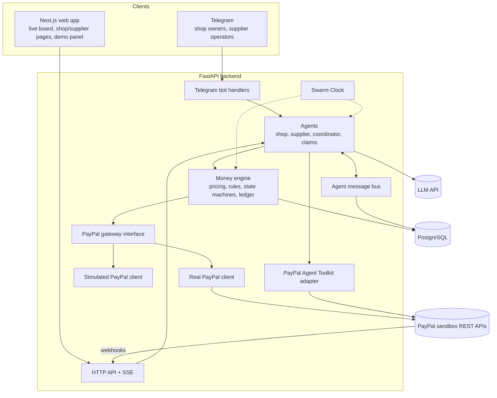

# Architecture

This document grows phase by phase. It describes how the pieces fit together and why.

## System overview

## Layers and rules

| Layer | Responsibility | May call |
|---|---|---|
| Interfaces (API, bot) | Translate HTTP / Telegram into commands | Agents, read models |
| Agents | Decide *what* to do, write messages | Money engine, LLM wrapper, toolkit (allow-listed) |
| Money engine | Decide *amounts* and *whether* a money action is allowed | PayPal gateway, ledger |
| PayPal gateway | Talk to PayPal (or simulate it) with idempotency | PayPal REST |

The money engine is the only code allowed to move money. Agents ask it; they never call the
capture/void/payout endpoints directly.

## PayPal gateway

`app/paypal/interface.py` defines `PayPalGateway`, a protocol implemented by:

- `PayPalClient` (`client.py`): async httpx client for the real sandbox. OAuth tokens are
  cached until shortly before expiry. Every mutation carries a `PayPal-Request-Id` derived
  from a stable idempotency key, so retries never double charge. Errors are mapped to typed
  exceptions that carry PayPal's `debug_id` and issue codes.
- `SimulatedPayPalClient` (`simulated.py`): in-memory implementation with the same
  behaviour rules as PayPal (capture limits, final capture, the 3-day honor period for
  reauthorization, refund limits, idempotent replays). IDs are prefixed `SIM-`.

Which one a shop or supplier uses is decided by its `paypal_mode` (`REAL` or `SIMULATED`).

## Time

All scheduling reads the Swarm Clock (`app/clock.py`), never the system clock, so the demo
can move through a week in minutes and tests can check time rules such as the honor period.
