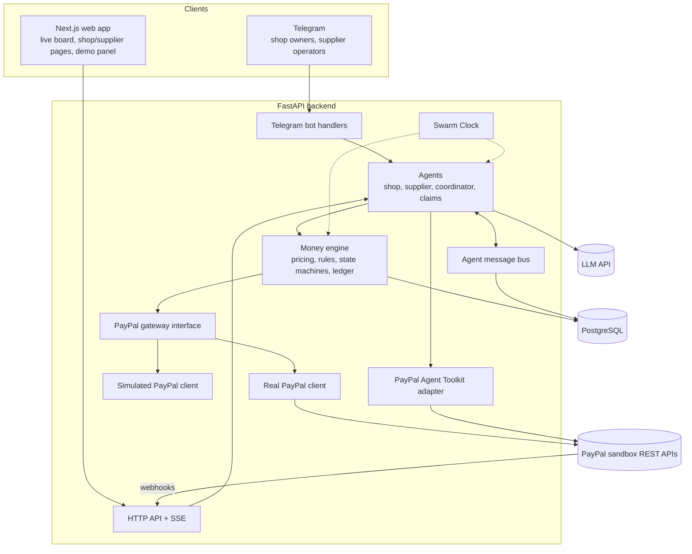
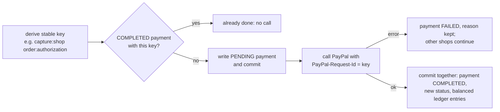
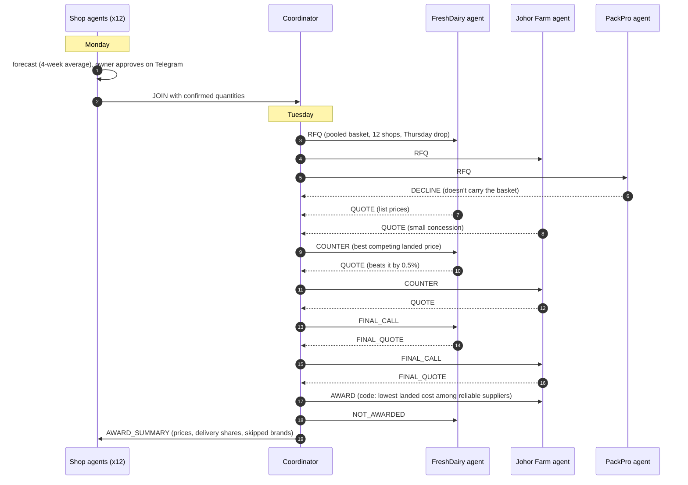

# Architecture

This document grows phase by phase. It describes how the pieces fit together and why.

## System overview



## Layers and rules

| Layer | Responsibility | May call |
|---|---|---|
| Interfaces (API, bot) | Translate HTTP / Telegram into commands | Agents, read models |
| Agents | Decide *what* to do, write messages | Money engine, LLM wrapper, toolkit (allow-listed) |
| Money engine | Decide *amounts* and *whether* a money action is allowed | PayPal gateway, ledger |
| PayPal gateway | Talk to PayPal (or simulate it) with idempotency | PayPal REST |

The money engine is the only code allowed to move money. Agents ask it; they never call the
capture/void/payout endpoints directly.

## PayPal gateway

`app/paypal/interface.py` defines `PayPalGateway`, a protocol implemented by:

- `PayPalClient` (`client.py`): async httpx client for the real sandbox. OAuth tokens are
  cached until shortly before expiry. Every mutation carries a `PayPal-Request-Id` derived
  from a stable idempotency key, so retries never double charge. Errors are mapped to typed
  exceptions that carry PayPal's `debug_id` and issue codes.
- `SimulatedPayPalClient` (`simulated.py`): in-memory implementation with the same
  behaviour rules as PayPal (capture limits, final capture, the 3-day honor period for
  reauthorization, refund limits, idempotent replays). IDs are prefixed `SIM-`.

Which one a shop or supplier uses is decided by its `paypal_mode` (`REAL` or `SIMULATED`).

## Time

All scheduling reads the Swarm Clock (`app/clock.py`), never the system clock, so the demo
can move through a week in minutes and tests can check time rules such as the honor period.
New and updated rows are stamped with the same clock (`app/db/base.py`), so a payment made
on the demo's Thursday morning shows Thursday 08:00 everywhere.

## Live updates

The message bus (`app/agents/bus.py`) stores every agent message and broadcasts it, along
with money engine events (holds, captures, payouts, refunds, invoice checks), to
`/api/stream` as Server-Sent Events. The web app keeps one `EventSource` open
(`frontend/lib/live.tsx`) and derives everything live from it:

- the two feeds (agent conversation, PayPal activity);
- **flights** on the swarm map: every message and payment becomes a streak between the two
  agents involved (`lib/flights.ts` maps agents and money movements to map nodes);
- the **story** the narrator tells (`lib/story.ts` turns events into one plain sentence);
- pulses, swap arcs and toasts.

All of that bookkeeping is one pure step function, `ingest` in `frontend/lib/stream-state.ts`:
state in, one stream item in, state out. The live connection feeds it items as they arrive.

### Recording and replay

Before anything is sent, the bus hands it to a recorder (`app/agents/recorder.py`), which
writes it to `stream_events` through its own short transaction and returns its position in
the stream. That position is sent as the event's SSE `id`.

- **Replay.** `GET /api/timeline` returns a week of the recording. The watch page
  (`frontend/components/theatre.tsx`) feeds it through the same `ingest` on a timer
  (`lib/replay.ts`, `lib/use-player.ts`), so the map, the story and the feeds play back with
  no extra code. The numbers a live page would ask the server for (who has money held, what
  has been charged) are worked out from the events alone in `lib/world-state.ts`; each
  finished step's event carries the server's totals, which replace the running ones.
- **Catching up.** A browser that reconnects sends `Last-Event-ID`; the stream first replays
  what was recorded since, then carries on live, without duplicates.
- A recorder failure is logged and the event is still sent: the week matters more than its
  recording.

Shortly after any event it revalidates every cached query, so tiles, grids and charts always
agree with the database. The demo week is fixed (`DEMO_WEEK`, a Monday), so the same numbers
appear on any day.

## Who may act for a shop

| Path | Demo mode | Production (`DEMO_MODE=false`) |
|---|---|---|
| Telegram `/start` | Shop code, or `/as` to switch | Signed invite from `python -m app.cli invite` (7 days) |
| Connect PayPal | Open to anyone | Signed link for that one shop (2 days), from the bot's `/connect` |
| Web phone (`/api/owners/*`) | Behind `DEMO_PANEL_KEY` if set | Off |
| Demo controls (`/api/demo/*`) | Behind `DEMO_PANEL_KEY` if set | Off |

Links are HMAC-signed with `SECRET_KEY` over purpose, shop and expiry (`app/security.py`).

## PayPal flows

One-time connect (owner present) and every later hold (owner not present):

```mermaid
sequenceDiagram
  autonumber
  participant O as Shop owner
  participant S as Swarm backend
  participant P as PayPal

  Note over O,P: Once per shop: /connect/[shopId]
  S->>P: POST /v2/checkout/orders (AUTHORIZE, vault store_in_vault=ON_SUCCESS)
  P-->>S: PAYER_ACTION_REQUIRED + payer-action link
  S->>O: redirect to PayPal
  O->>P: log in and approve
  P-->>S: return_url
  S->>P: POST /orders/{id}/authorize
  P-->>S: authorization + vault ID (saved on the shop)

  Note over O,P: Every week, no owner needed
  S->>P: POST /v2/checkout/orders (AUTHORIZE, vault_id)
  P-->>S: authorization (the hold)
  S->>P: POST /authorizations/{id}/capture (delivered qty, final_capture=true)
  P-->>S: capture; the rest of the hold is released
  S->>P: POST /v1/payments/payouts (supplier share minus platform fee)
```

The supplier side uses the PayPal Agent Toolkit for invoicing. Holds, captures, voids,
reauthorizations, refunds, payouts and vaulting use Swarm's own client, because the toolkit's
order tools only capture immediately. See [paypal-notes.md](paypal-notes.md).

## Webhooks

`POST /webhooks/paypal` verifies each delivery with PayPal's verify-webhook-signature API, using
the exact raw body, and rejects anything unverified with HTTP 400. Phase 2 adds exactly-once
processing (unique `paypal_event_id`) and reconciliation of payments from the events.

## Data model

Twenty-two tables (`backend/app/db/models.py`, one Alembic migration). Money is always integer
cents plus a currency code. The database itself refuses impossible states with CHECK
constraints: a capture larger than its hold, a refund larger than its capture, a delivered
quantity above the ordered one, or a status that is not part of the state machine.

Refinements to the spec's list, and why:

| Table | Why it exists |
|---|---|
| `shop_orders` | One shop's part of a group order. It carries the single PayPal hold for that shop and week (rather than one hold per item), the hold/captured/refunded amounts and the line state machine. `group_order_lines` keep the per-item quantities and agreed prices beneath it. |
| `purchase_history` | Generated weekly orders from before Swarm: the "buying alone" baseline for savings, and history for demand prediction. |
| `approval_requests` | Questions for owners (confirm needs, over the spending limit, substitutions, swaps), answered in Telegram. |
| `app_state` | The Swarm Clock's position and the simulated PayPal's snapshot, so every process agrees on "now" and simulated holds survive restarts. |

Items are SKUs. Brand variants of one product (`Meadowfresh`, `Hilltop` and `Farm Gold` full
cream milk) share a `product_code`; shops forecast per product, suppliers quote their SKU for
it, and a shop's line only moves to the winner's brand if its preferences allow it.

## Money engine

`app/money/engine.py` is the only code that moves money. Each step (hold, reauthorize,
capture, void, refund, payout, swap charge, swap payout) follows the same pattern:



A crash between the PayPal call and the final commit leaves a PENDING row; running the step
again sends the same request ID, PayPal returns the original result, and nothing is charged
twice (tested).

Rules applied before every call (`app/money/rules.py`): weekly spending limit (over it, the
owner is asked and nothing is held until they approve), supplier floor and stock, capture never
above the hold, refund never above the capture. Before capturing, a hold older than the 3-day
honor period is reauthorized; one older than 29 days is replaced by a new hold on the saved
wallet.

Amounts (`app/money/pricing.py`):
- hold = sum(qty x agreed price) + the shop's delivery share,
- capture = sum(delivered qty x agreed price) + the delivery share scaled by the weight that
  actually arrived, captured with `final_capture = true` so the rest of the hold is released,
- delivery share: proportional to `weight_grams x (500 + metres from the drop point)`, split
  with the largest-remainder method so shares always add up to the fee exactly,
- supplier payout = what was captured for the group order, minus refunds, minus the platform
  fee (basis points, rounded down).

## Ledger

`app/money/ledger.py`. Every money event is one balanced transaction group. The accounts are
named by shop and supplier code (`shop:cafe-mei:paypal`, `supplier:freshdairy:payable`,
`platform:clearing`, `platform:fees`, plus memo accounts for outstanding holds). The platform's
books obey one invariant: the money in `platform:clearing` equals fees earned plus what is
still owed to suppliers and shops. The four-week simulation test checks this, and that the
hold memo matches the outstanding authorizations, after every day.

## Agents



- `app/agents/base.py`: identity, mandate, prompt and the `validate()` gate. `require()` refuses
  and audits anything outside the agent's tools or mandate, and reports which rules an allowed
  action passed. `decided()` keeps a decision record in the audit log next to the message
  that announced it: the options code built, who chose, the rules passed. The web app's
  inspector reads it (`GET /api/agent-messages/{id}/decision`). The record never travels in
  the message, so the other side of a negotiation cannot see a supplier's options.
- `app/agents/supplier_agent.py`: code builds the legal options (hold, small, beat, deep, and
  floor in the final round), the model picks one and writes the reply, and a style-based
  policy decides when no model is available.
- `app/agents/coordinator.py`: the protocol (at most 3 rounds, stops early when nobody moves),
  counters that reveal only the best competing landed price, and the award by rule.
- `app/agents/shop_agent.py` and `claims_agent.py`: owner-facing messages, intents, and
  photo-based claim assessment with code deciding the refund.
- `app/agents/bus.py`: every message is stored in `agent_messages` and streamed over
  Server-Sent Events (`GET /api/stream`). The money engine's events (holds, captures, payouts,
  refunds) share the same stream.
- `app/llm/client.py`: the only place that calls the model. It uses structured outputs (a
  Pydantic schema per answer), effort `low` for messages and `medium` for photo review,
  timeouts and retries, and handles `refusal`/`max_tokens` stop reasons. It logs prompt name,
  latency and tokens, and has offline and scripted variants for the demo and the tests.
